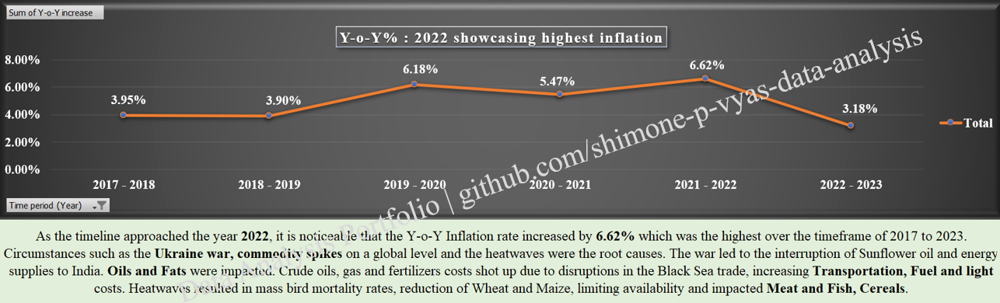
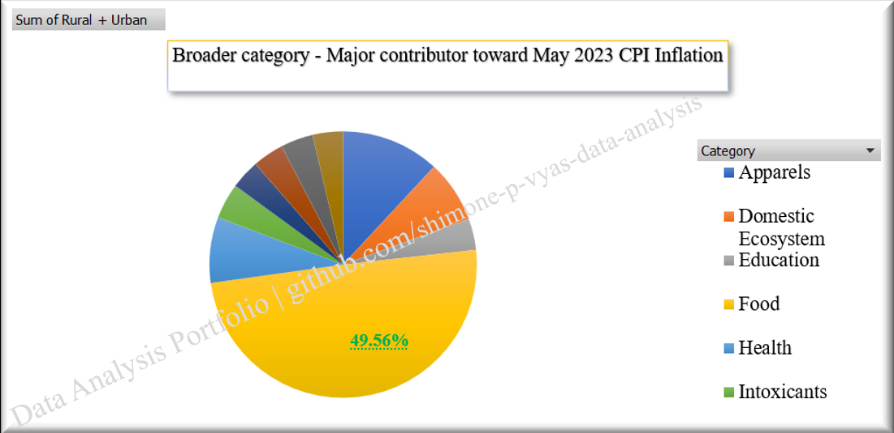
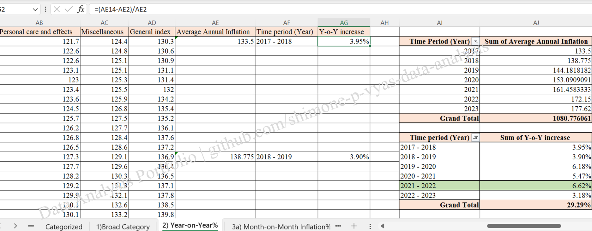
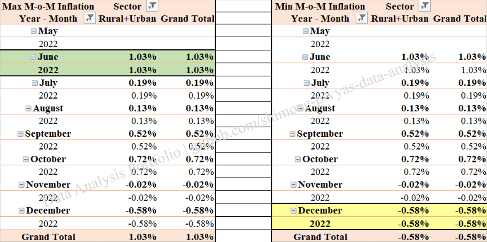
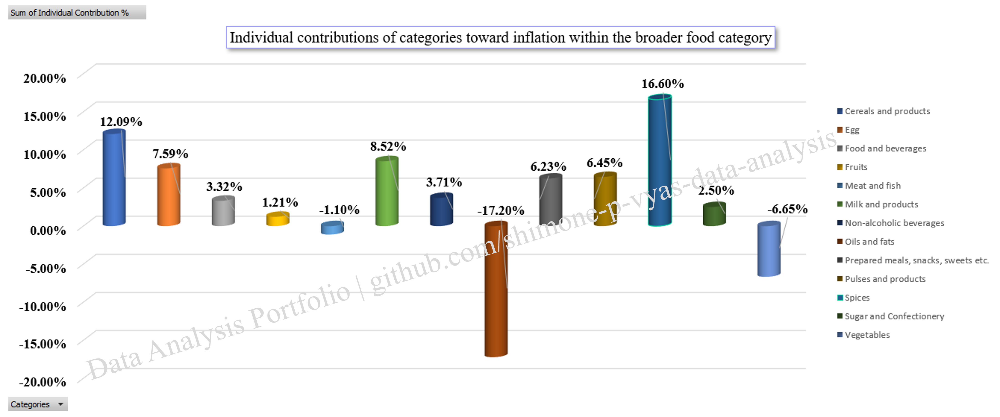
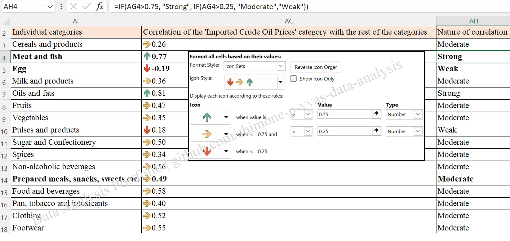
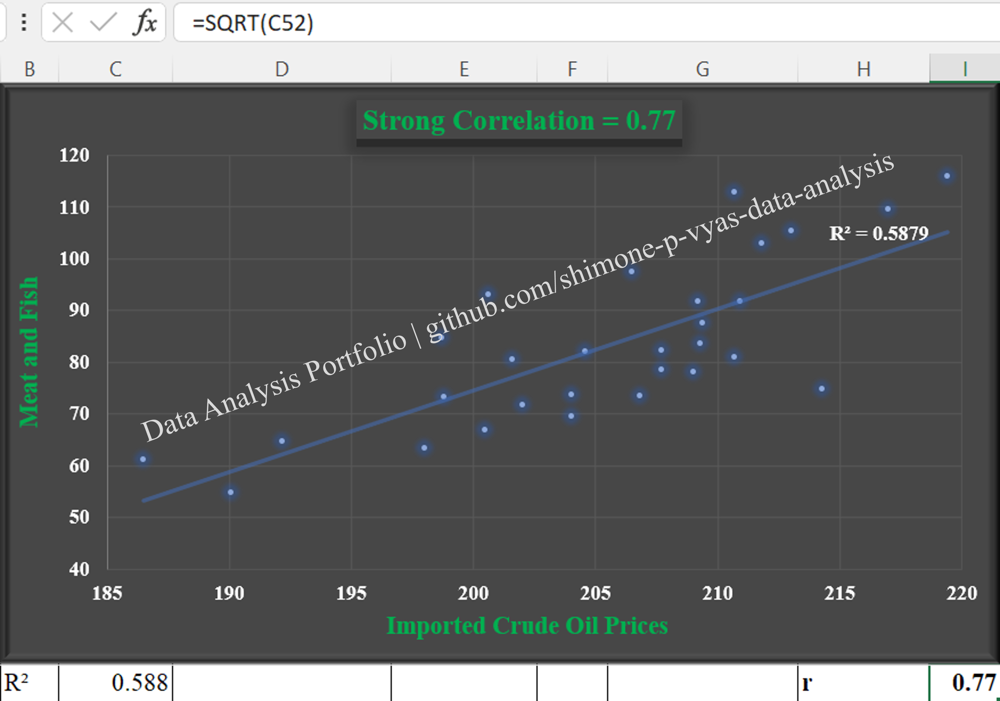

# Analytics Excel Case Study: India Consumer Price Index Inflation
*Case Study Completion Date:* *April 27, 2026*

 

## **Data and Repository Restrictions**

> To maintain academic integrity for ongoing peer cohorts, the institutional source data and my final .xlsx workbook are withheld from the repository.

> Visual assets are watermarked for portfolio integrity. 

## Case Study Overview 
Comprehensive Excel Analytics Case Study on India's Consumer Price Index Inflation. 
- Comprises raw data cleaning, **diagnostic analysis** and **visualizations**.
- Utilized a **Multi-Horizon time-series analysis : Year-on-Year (Y-o-Y), Month-on-Month (M-o-M)** to track trends.
- Extracted **macroeconomic insights**.
- **Correlated the Imported global crude oil prices** with the rest of the individual categories.
- Isolated the underlying Food **supply shocks**.

## Data Source
- Utilized an officially provisioned case study dataset curated from an open-source **GOI** public data repository containing relevant records from **January 2013 - May 2023**.
- The **imported Crude oil values** from **January 2021 - May 2023** for the **Rural+Urban** sector were sourced directly from the internet. The values presented are based on historical market records.

## Data Cleaning
* Cleaned and structured 373 rows of data.
* Performed deletion of 3 rows of May 2020 (0.08% of the dataset) as they were 'NA'.
* Cleaned missing data fields by standardising 'NA' and string hyphens '-' to 0, thus eliminating calculation breaks.
* For Rural Sector in April 2020, linear interpolations were computed.
* **`Linear interpolation: April 2020 = March 2020 + June 2020 / 2`**
* Used **`TRUNCATE()`** function to 1 decimal place to maintain data consistency.

## Data Analysis Report Sequence
| File Order | Description |
| :--- | :--- |
| **1. `food-contribution.png`** | Upto **50%** contribution to inflation across sectors by the major and broad **Food** category |
| **2. `yoy-inflation.png`** | **Y-o-Y inflation%** computed |
| **3. `yoy-inflation-peak.png`** | **2022** highlighted as the period of peak inflation |
| **4. `mom-inflation-deflation-peak.png`** | **June 2022** had the **highest M-o-M inflation%** of **1.03** while **December 2022** saw a **M-o-M deflation%** of **-0.58** |
| **5. `food-breakdown-sub-categories.png`** | **Spices** contributing upto **16.6%**, is the largest within the Food category |
| **6. `correlation-icon-set-classification.png`** | Calculation of Correlation for the Imported Crude Oil Prices with all the sub-categories |
| **7. `strong-correlation-scatterplot.png`** | Strong Correlation of **0.77** between the Imported Crude Oil Prices and the Meat and Fish category |

## Highest contribution within the broader categories : May 2023

- The contributions of each of the broader categories were calculated by dividing their respective values with the summation of all the rest of the categories.
- For the Food Category: **`Food category value / sum of all categories`**
-  The **Food category** had the highest/most significant contribution upto half **(49.56%)** towards the CPI calculation across all the three sectors.
-  **Spices, Meat and Fish** were the underlying driving factors having inflation rates of **9.23% to 9.65%**.

## Year that depicted the highest inflation : 2017 - 2023

- Average Annual Inflations were computed by averaging the General Index values over the period of 12 months.
- Year-on-Year increase % :  **`Average Annual Inflation of the current year - Average Annual Inflation of the previous year / Average Annual Inflation of the previous year`**
- **2022** showcased the highest inflation of about **6.62%** in the Rural+Urban Sector.

## Months indicating highest inflation, deflation : May 2022 - Dec 2022

- Month-on-Month inflation and deflation % : **`Inflation of the current month - Inflation of the previous year / Inflation of the previous month`**
- **June** experienced the highest food **inflation** of **1.03%** and **December** a **deflation** of **-0.58%** in the Rural+Urban Sector.
- After adding up all the Month-on-Month inflation percentages across the narrow individual categories, **Spices** turned out to be the biggest individual contributor with **16.6%** followed by **Cereals and Products** with **12.09%** primarily due to **erratic monsoons** and **soaring temperatures of 42°C - 46°C**.

## Correlation of various categories with Imported Crude Oil Prices : 2021 - 2023

- Correlation bifurcation criteria was preset by utilizing **`icon sets`**.

| Value | Type of Correlation |
| :--- | :--- |
| **`0.00 - 0.25`** | Weak |
| **`0.26 - 0.74`** | Moderate |
| **`0.75 - 1.00`** | Strong |
- Correlation values of the Imported Crude Oil Prices with the remaining categories were generated using **`correl()`**, **`nestedif`** formulae.

## Strong Correlation of Imported Crude Oil Prices, Meat and Fish Category

- Strong Correlation of the Imported Crude Oil Prices with Meat and Fish was 0.77.
- This was graphically depicted through a Scatterplot. A trendline was added along with the R² equation.
- **`The correlation co-efficient (r) : the square root of the R² value`**.
- Domestic diesel costs skyrocketed by **85%** due to India's Crude Oil imports. This caused inflations around **refrigerated trucks** that were rushing **perishable Fish and Meat** to the processing industries.
- Diesel expenses for the functioning of **Poultry farm machinery**, **milling feed** and **bird transportations**, thereby inflating **Chicken and Egg prices**.

## Excel Capabilities and Skills
- Microsoft Excel
- Pivot Tables
- Pivot Charts : Pie, Line with Markers, 3-D Stacked Column, Scatterplot 
- Excel formulae : Multi-Horizon time-series - Year on Year, Month on Month calculations
- Data wrangling : Data cleaning, Data re-structuring, Data categorization
- Data Analysis and Insights : Data Analytics, Diagnostic Analysis, Exploratory Data Analysis (EDA), Bivariate, Macroeconomic
- Data Visualization : Vivid and streamlined summaries

